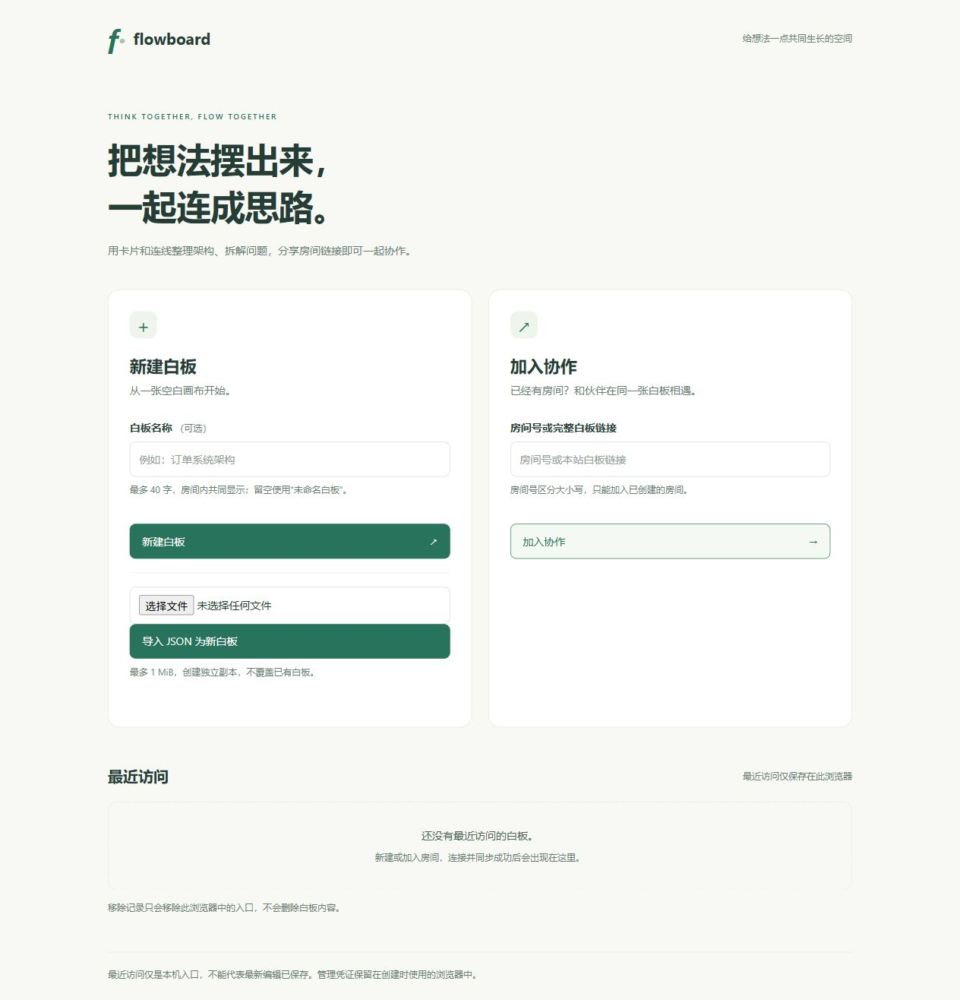

# Flowboard

基于 Vue 3、Vue Flow 和 Yjs 的实时协作白板。用卡片和连线整理思路，通过房间链接邀请协作者，白板内容保存在 MySQL 中。

**在线演示：[打开 Flowboard](http://8.149.237.91/flowboard/)**

当前演示使用 HTTP，请勿填写敏感信息。无需注册；知道房间链接即可编辑，创建者浏览器持有的管理凭证用于删除房间。

## 页面预览



## 功能

- 创建房间、通过房间号或链接加入、本机最近访问记录。
- 添加、复制和删除卡片，编辑标题、正文和颜色，连接节点，框选与本地撤销/重做。
- 实时同步节点和连线，显示在线成员、昵称、光标及编辑状态。
- 远端坐标更新按浏览器帧合并，使用约 70ms 显示过渡，本地拖动保持直接响应。
- MySQL 保存完整 Yjs 文档，支持后端正常重启恢复、保存失败提示和有限重试。
- 管理凭证校验、删除在线房间并通知协作者退出。
- 导出 JSON，导入文件为独立新房间。导入上限 1 MiB，不覆盖已有内容。

## 技术栈与目录

| 部分        | 技术与职责                                                      |
| ----------- | --------------------------------------------------------------- |
| `frontend/` | Vue 3、TypeScript、Vue Flow、Vue Router、Vite；画布和交互       |
| `backend/`  | Node.js、ws、Yjs WebSocket 服务、mysql2；房间接口与协作生命周期 |
| `shared/`   | 前后端共用的 JSON 文件格式校验                                  |
| `deploy/`   | Nginx 路径分流示例与部署说明                                    |
| `docs/`     | 数据流、持久化与权限设计                                        |

前后端分别管理 npm 依赖，不需要 Redis 或额外数据库服务。

## 本地运行

需要 Node.js 24（24.12+）和 MySQL 8。以下命令在仓库根目录执行。

```sh
npm --prefix backend ci
npm --prefix frontend ci
```

创建独立数据库，例如：

```sql
CREATE DATABASE flowboard CHARACTER SET utf8mb4 COLLATE utf8mb4_unicode_ci;
USE flowboard;
SOURCE /你的项目路径/backend/sql/001_rooms.sql;
```

复制 `backend/.env.example` 为 `backend/.env`，填写 MySQL 连接信息。运行账号需要 `flowboard_rooms` 表的 SELECT、INSERT、UPDATE、DELETE 权限。应用不会自动建库建表。

分别在两个终端启动：

```sh
npm --prefix backend run dev
npm --prefix frontend run dev
```

后端默认端口为 3000；前端地址以 Vite 终端输出为准。开发时 `/api` 由 Vite 代理，WebSocket 默认连接当前主机的 3000 端口。可用 `frontend/.env.local` 的 `VITE_WS_URL` 覆盖地址，修改后重启开发服务。

## 设计要点

**协作数据与在线状态分开。** 节点和连线保存在 Y.Doc，节点 `data` 使用嵌套 Y.Map，位置以 `{x, y}` 整体更新。Awareness 保存昵称、光标和编辑提示；本地选择、视口和显示动画不写入文档。Awareness 防误删属于交互提示，不是可靠锁或授权。

**广播与持久化分开。** 文档更新通过 WebSocket 同步，数据库默认每两秒窗口保存完整二进制快照。同一房间串行保存；最后一端退出后保存再释放内存。重新进入时，先从数据库恢复文档，再建立协作连接。

**删除权限在服务端校验。** 创建房间时返回随机管理 token，浏览器保存在 localStorage，数据库只保存 SHA-256 哈希。删除前冻结写入并等待在途保存，避免删除后被迟到保存重建。同一浏览器的普通窗口共享管理凭证，昵称和 Awareness 不参与授权。

**导入创建新房间。** 前后端校验格式版本、坐标、节点 ID 和连线引用，后端将完整初始文档与房间资料一次写入数据库，再返回新房间及新凭证。导出仅包含业务数据，不包含凭证、在线状态或 Yjs 历史。

更多说明见 [协作设计](docs/协作白板说明.md)。

## 构建与部署

```sh
npm --prefix frontend run build
npm --prefix backend run check
```

前端产物在 `frontend/dist/`；后端直接运行 JavaScript，无需转译。生产前端默认部署在 `/flowboard/`，HTTP 使用 `/flowboard/api/`，WebSocket 使用 `/flowboard/ws/`。

部署时保留 `backend/` 与 `shared/` 的相对位置，在服务器安装后端依赖、配置 `.env`，再启动服务。通过 Nginx 转发时设置 `HOST=127.0.0.1`，避免直接暴露后端端口。`VITE_WS_URL` 是前端构建时配置，不会随服务器 `.env` 改变。

具体步骤见 [部署说明](deploy/部署说明.md)。真实 `.env`、私钥、依赖、构建产物和临时部署包均不提交 Git。

## 测试与验证

```sh
npm --prefix frontend test
npm --prefix backend test
npm --prefix frontend run type-check
npm --prefix backend run check
```

前端测试覆盖文档合并、撤销、防误删、文件入口依赖的房间接口、最近访问和动画生命周期；后端测试覆盖房间接口、管理凭证、WebSocket、保存/释放/删除竞争以及文件导入校验。默认后端测试使用存储替身。

真实 MySQL 自动测试需要独立的本机测试库，库名以 `flowboard_test_` 开头。参照 `backend/.env.test.example` 配置 `.env.test.local`，在 backend 目录执行 `npm run test:mysql`；缺少配置时会跳过，不会操作业务库。

2026-10-24 验证记录：

- 前端 41 项测试通过；后端 26 项通过、1 项独立 MySQL 测试因未配置而跳过。
- 生产构建、类型检查和修改涉及的 ESLint 检查通过。
- 用户已体验双端协作、远端拖动平滑及 JSON 导入导出。
- 经用户授权，线上白板正常重启前后的文档摘要一致；全新 WebSocket 客户端恢复了 2 个节点、0 条连线的完整内容。
- 线上导入接口完整写入 MySQL，临时验收房间已删除。

以上不代表容量压测、断电恢复或真实数据库故障恢复已经完成。

## 当前边界

- 单后端进程，不支持多实例共享在线房间状态。
- 无账号体系、只读角色和凭证找回；清理浏览器数据或换设备可能失去删除权限。
- 浏览器未使用 IndexedDB 保存离线编辑。尚未同步的修改可能在刷新后丢失，可先导出备份。
- 快照保存存在延迟，强杀进程可能丢失最近一次成功保存之后的修改。
- 默认最多 200 个房间、20 个活动房间、40 个连接；单文档 4 MiB。属于演示限制，不是压测能力承诺。
- 超出 1 MiB 的导出文件可保留作数据备份，但不能通过当前导入入口恢复。
